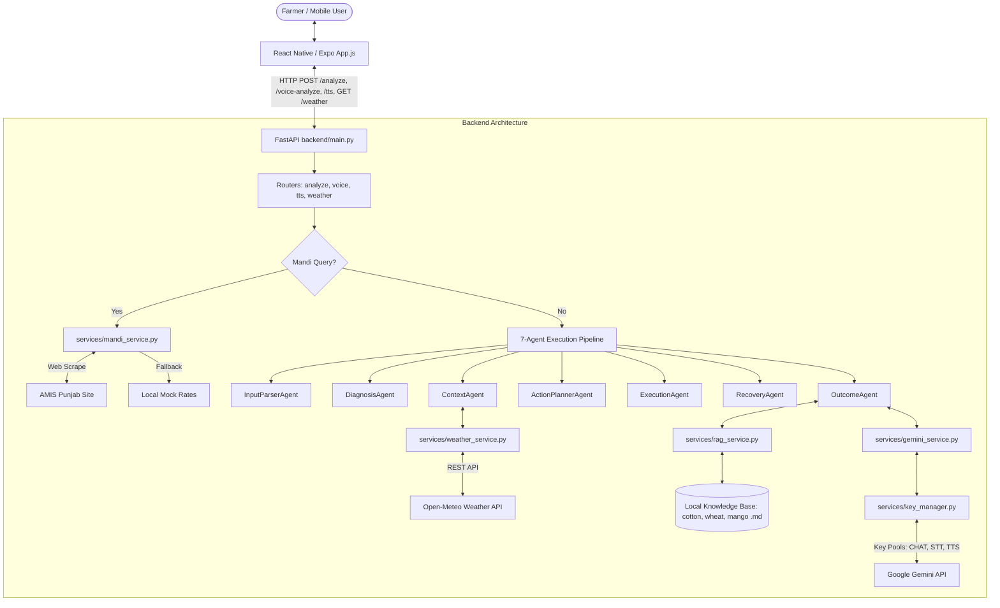
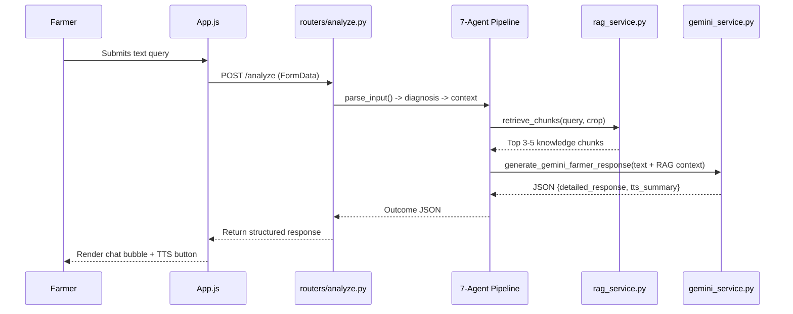
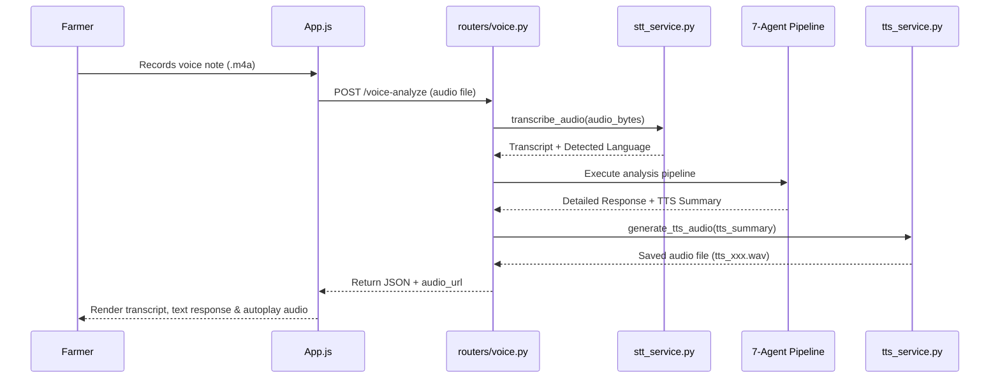

# PROJECT AUDIT & SYSTEM HANDOVER DOCUMENT: FarmAI / KisaanAI

**Document Status:** Complete & Verified Code-Based Audit  
**Target Repository:** FarmAI / KisaanAI (Root: `a:\mehruLaibaAliIsa@nu`)  
**Audit Date:** September 2026  
**Primary Purpose:** Comprehensive system blueprint and handover document for future LLMs, developers, and maintainers.

---

## TABLE OF CONTENTS
1. [Executive Summary](#1-executive-summary)
2. [Frontend Architecture](#2-frontend-architecture)
3. [Backend Architecture](#3-backend-architecture)
4. [Complete AI / Agent Pipeline](#4-complete-ai--agent-pipeline)
5. [Multilingual System](#5-multilingual-system)
6. [Voice Pipeline](#6-voice-pipeline)
7. [Image / Multimodal Pipeline](#7-image--multimodal-pipeline)
8. [Knowledge Base & RAG System](#8-knowledge-base--rag-system)
   - [How to Safely Extend the Knowledge Base](#how-to-safely-extend-the-knowledge-base)
9. [Weather System](#9-weather-system)
10. [Mandi Rate System](#10-mandi-rate-system)
11. [Gemini & Google Technology Integration](#11-gemini--google-technology-integration)
12. [API Key Management & Reliability](#12-api-key-management--reliability)
13. [Input Validation & Relevance System](#13-input-validation--relevance-system)
14. [API Endpoint Reference](#14-api-endpoint-reference)
15. [Complete Feature Inventory](#15-complete-feature-inventory)
16. [File-by-File Architecture Map](#16-file-by-file-architecture-map)
17. [Data Flow Diagrams (Mermaid)](#17-data-flow-diagrams-mermaid)
18. [Current Project State](#18-current-project-state)
19. [Critical Invariants (DO NOT BREAK)](#19-critical-invariants-do-not-break)
20. [Context for a Future LLM](#20-context-for-a-future-llm)
21. [Environment & Deployment Configuration](#21-environment--deployment-configuration)

---

## 1. EXECUTIVE SUMMARY

FarmAI (also referenced as KissanAI-2) is an AI-powered agricultural advisory platform engineered specifically for Pakistani farmers. The platform provides localized crop disease diagnostics, weather-based spray/irrigation advice, live market (Mandi) rates, and multilingual voice/text support across Urdu, Roman Urdu, English, Punjabi, and Siraiki.

### Key Architectural Findings:
- **Frontend Stack:** React Native (v0.81.5) built on Expo SDK 54 (`~54.0.0`) with Async-Storage, Expo-Location, Expo-AV, and Expo-Image-Picker.
- **Backend Stack:** FastAPI (v0.1.0) running on Uvicorn, Python 3.10+, utilizing Google Gemini generative AI (`google-generativeai` SDK).
- **Core AI Engine:** Hybrid architecture featuring a 7-Agent execution pipeline, local keyword-scoring RAG (Retrieval-Augmented Generation), domain-based API Key Rotation Pools, live Open-Meteo weather integration, and AMIS Punjab Mandi scraping with fallback datasets.
- **Key Caveat:** The repository contains unused placeholder directories (`backend/rag/` files are 1 byte each, `backend/knowledge_base/` `.txt` files are 1 byte each) whereas the *actual active logic* resides in `backend/services/rag_service.py` reading from `.md` files inside `backend/cotton/`, `backend/wheat/`, and `backend/mango/`.

---

## 2. FRONTEND ARCHITECTURE

The frontend is a React Native app built using Expo SDK 54 located in `frontend/`.

### Entry Point & Navigation
- **File:** `frontend/App.js` (1291 lines)
- **Navigation Model:** State-driven single-page navigation via `currentScreen` state (`'Home'`, `'Chat'`, `'Weather'`). It does *not* use React Navigation or Expo Router.

### UI Screens & Layouts
1. **Home Screen (`currentScreen === 'Home'`):**
   - Header with title `🌾 کسان AI` and subtitle `آپ کا زرعی مددگار`.
   - Navigation cards for "گفتگو" (Chat) and "موسم" (Weather).
2. **Chat Screen (`currentScreen === 'Chat'`):**
   - Header with back button, title, and "🗑️ صاف کریں" (Clear Chat with `Alert.alert` confirmation).
   - `KeyboardAvoidingView` containing a `ScrollView` of chat bubbles (`user`, `ai`, `error`).
   - `MultimodalInput` component anchored at the bottom.
3. **Weather Screen (`currentScreen === 'Weather'`):**
   - Renders `WeatherCard` component with live location and Open-Meteo weather metrics.

### Frontend Components & Responsibilities

| Component | Path | Responsibilities & Calling Hierarchy | Key Dependencies |
| :--- | :--- | :--- | :--- |
| `App.js` | `frontend/App.js` | App entry point, screen router, chat history manager, geolocation initializer, audio playback state controller (`soundRef`), TTS trigger (`handlePlayTTS`), handleSubmit orchestration. | `react-native`, `@react-native-async-storage/async-storage`, `expo-location`, `expo-av` |
| `MultimodalInput.js` | `frontend/components/MultimodalInput.js` | Text input, voice recording (`Audio.Recording`), media picker bottom modal (Gallery & Camera), image preview thumbnail. | `expo-image-picker`, `expo-av` |
| `WeatherCard.js` | `frontend/components/WeatherCard.js` | Displays temperature, humidity, rain probability, spray advice, and irrigation advice. | `react-native` |
| `LoadingSpinner.js` | `frontend/components/LoadingSpinner.js` | Multi-step animated text spinner (`setInterval` 3s) localized into Urdu script, Roman Urdu, or English based on `detectQueryLanguage`. | `react-native` |
| `api.js` | `frontend/services/api.js` | HTTP client wrapper for backend communicating with `http://192.168.1.9:8000` (60s timeout abort controller). Calls `/analyze`, `/voice-analyze`, `/tts`, `/weather`. | `fetch` API, `FormData` |
| `ActionChainCard.js` | `frontend/components/ActionChainCard.js` | Present in codebase for visual step-by-step diagnostic breakdown. | `react-native` |
| `ResponseCard.js` | `frontend/components/ResponseCard.js` | Present in codebase for formatted advice cards. | `react-native` |
| `DashboardAnalytics.js` | `frontend/components/DashboardAnalytics.js` | Present in codebase for telemetry/metrics rendering. | `react-native` |
| `LogsViewer.js` | `frontend/components/LogsViewer.js` | Present in codebase for agent debug log inspection. | `react-native` |
| `formatter.js` | `frontend/utils/formatter.js` | Utility functions for text formatting and currency display. | JavaScript |

### Permissions & Device Sensors
- **Location:** Requested via `Location.requestForegroundPermissionsAsync()`. Used for GPS coordinates (`latitude`, `longitude`) sent to `/weather`, `/analyze`, and `/voice-analyze`.
- **Microphone:** Requested via `Audio.requestPermissionsAsync()`. Configures `Audio.setAudioModeAsync({ allowsRecordingIOS: true, playsInSilentModeIOS: true })`.
- **Camera & Gallery:** Requested via `ImagePicker.requestCameraPermissionsAsync()` and `ImagePicker.requestMediaLibraryPermissionsAsync()`.

### Local Storage & Persistence
- **Key:** `farmai_chat_messages`
- **Engine:** `@react-native-async-storage/async-storage`
- **Behavior:** Loads chat array on app mount; saves on every `chatMessages` state update; clears on user confirmation.

---

## 3. BACKEND ARCHITECTURE

The backend is built with FastAPI (`backend/main.py`), hosted via Uvicorn.

```
backend/
├── main.py                   # FastAPI initialization, CORS, static mounting, RAG startup event
├── .env / .env.example       # API Key configuration & model declarations
├── requirements.txt          # Dependencies: fastapi, uvicorn, python-multipart, requests, python-dotenv, google-generativeai, pillow
├── routers/
│   ├── analyze.py            # POST /analyze (Text/Image 7-agent pipeline & Mandi intercept)
│   ├── voice.py              # POST /voice-analyze (Audio STT -> Pipeline -> TTS & Mandi intercept)
│   ├── tts.py                # POST /tts (Standalone Text-to-Speech)
│   ├── weather.py            # GET /weather & GET /weather-mock (Open-Meteo wrapper)
│   └── health.py             # GET /health & GET /gemini-status (Key & Model discovery status)
├── services/
│   ├── gemini_service.py     # Gemini text generation, prompt engineering, validation, Roman conversion
│   ├── key_manager.py        # Domain-specific multi-key pool rotation (CHAT, STT, TTS)
│   ├── stt_service.py        # Audio transcription via Gemini multimodal audio understanding
│   ├── tts_service.py        # Text-to-Speech audio generation via Gemini preview TTS models
│   ├── rag_service.py        # Local keyword-scoring RAG engine for cotton, wheat, mango
│   ├── mandi_service.py      # Mandi intent detection, AMIS live web scraping, fallback rates
│   ├── weather_service.py    # Open-Meteo live API integration & agricultural advice engine
│   └── logging_service.py    # Standardized agent log creation & latency measurement
├── agents/                   # 7-Agent Workflow
│   ├── input_parser.py       # InputParserAgent
│   ├── diagnosis_agent.py    # DiagnosisAgent
│   ├── context_agent.py      # ContextAgent
│   ├── action_planner.py     # ActionPlannerAgent
│   ├── execution_agent.py    # ExecutionAgent
│   ├── recovery_agent.py     # RecoveryAgent
│   └── outcome_agent.py      # OutcomeAgent
├── utils/
│   ├── constants.py          # Disease maps, crop keywords, budget limits, healthy keywords
│   └── helpers.py            # Language detection, crop inference, relevance & blank image checks
├── wheat/                    # Wheat markdown knowledge files (.md)
├── cotton/                   # Cotton markdown knowledge files (.md)
└── mango/                    # Mango markdown knowledge files (.md)
```

---

## 4. COMPLETE AI / AGENT PIPELINE

When a user submits a standard farming query, the query travels through a 7-agent pipeline orchestrated across FastAPI routers and backend agents.

### Complete Step-by-Step Code Path:

```
[USER INPUT] (Text, Image, Location)
       │
       ▼
[Frontend: App.js -> services/api.js: analyzeCrop()]
       │ Multipart Form-Data POST
       ▼
[Backend Router: routers/analyze.py: analyze_crop()]
       │
       ├─► 1. InputParserAgent (agents/input_parser.py: parse_input())
       │      - Detects language (`helpers.detect_language()`) -> 'ur', 'roman_urdu', 'english'
       │      - Infers crop (`helpers.infer_crop()`) -> 'Cotton', 'Wheat', 'Mango', 'Unknown'
       │      - Extracts image bytes & MIME if present
       │
       ├─► [MANDI INTERCEPT CHECK] (services/mandi_service.py: is_mandi_rate_query())
       │      - If query is about Mandi rates -> Immediately calls `handle_mandi_query()` and returns.
       │
       ├─► 2. DiagnosisAgent (agents/diagnosis_agent.py: generate_mock_diagnosis())
       │      - Looks up disease in `constants.DISEASE_MAP` based on crop.
       │      - Applies confidence score & image boost (+0.07).
       │      - Checks if `needs_second_photo` (confidence < 0.55).
       │
       ├─► 3. ContextAgent (agents/context_agent.py: get_context())
       │      - Calls `services.weather_service.get_mock_weather(lat, lon)`.
       │      - Runs contradiction check: user says "crop is healthy" vs Diagnosis risk Medium/High.
       │
       ├─► 4. ActionPlannerAgent (agents/action_planner.py: plan_actions())
       │      - Builds a 3-5 step action chain (Diagnosis validation, Weather check, Treatment recommendation, Expert alert, 48h follow-up).
       │
       ├─► 5. ExecutionAgent (agents/execution_agent.py: execute_actions())
       │      - Simulates execution timestamps and status (`simulated_success`, `delayed`, `needs_recovery`).
       │
       ├─► 6. RecoveryAgent (agents/recovery_agent.py: apply_recovery())
       │      - Handles edge cases: low confidence -> request 2nd photo; treatment cost > Rs 2000 -> budget alternative; rain expected -> rain delay.
       │
       └─► 7. OutcomeAgent (agents/outcome_agent.py: format_outcome())
              │
              ├─► Relevance & Blank Image Check (`helpers.is_agriculture_related()`, `helpers.is_image_blank_or_solid()`)
              │      - If irrelevant or blank image -> returns polite refusal paragraph immediately.
              │
              ├─► Local RAG Retrieval (`services/rag_service.py: retrieve_chunks()`)
              │      - Scores knowledge chunks from `backend/cotton`, `backend/wheat`, `backend/mango`.
              │      - Formats top 3-5 chunks into `RAG_CONTEXT` string.
              │
              ├─► Gemini Generation (`services/gemini_service.py: generate_gemini_farmer_response()`)
              │      - Executes with key rotation (`key_manager.py: run_with_key_rotation('CHAT')`).
              │      - Prompt instructs Gemini to return JSON: `{"detailed_response": "...", "tts_summary": "..."}`.
              │      - Validates response (`_validate_response()`) against banned terms, JSON leaks, and language script requirements.
              │
              └─► Returns top-level structured JSON response to frontend `App.js`.
```

---

## 5. MULTILINGUAL SYSTEM

FarmAI supports **5 languages / dialects**:
1. **Urdu (اردو script)** — Full native support
2. **Roman Urdu** (Urdu in Latin script) — Full native support
3. **English** — Full native support
4. **Punjabi (Shahmukhi / Urdu script)** — Confirmed in prompt instructions, TTS & fallback conversion logic
5. **Siraiki (Shahmukhi / Urdu script)** — Confirmed in prompt instructions, TTS & fallback conversion logic

### Language Processing Breakdown:

- **Detection:**
  - `backend/utils/helpers.py: detect_language(text)`: Scans for Urdu Unicode range (`\u0600-\u06FF`), Roman Urdu keywords (`fasal`, `kapas`, `gandum`, `patton`, `bimari`), and English agricultural stop words.
  - `backend/services/stt_service.py: transcribe_audio()`: Gemini multimodal STT detects spoken language directly from audio and returns `Language: <Urdu|Roman Urdu|English|Punjabi|Siraiki>`.
- **Gemini System Prompt Customization (`services/gemini_service.py`):**
  - Adapts instructions and strict heading maps (`HEADINGS_MAP`) dynamically per language:
    - **Urdu:** `ممکنہ مسئلہ:`, `خطرے کی سطح:`, `تجویز کردہ عمل:`, `موسم کا خیال:`, `اگلا قدم:`
    - **Roman Urdu:** `Mumkin Masla:`, `Khatray ki Satah:`, `Tajweez Kardah Amal:`, `Mosam ka Khayal:`, `Agla Qadam:`
    - **English:** `Possible Issue:`, `Risk Level:`, `Recommended Action:`, `Weather Note:`, `Next Step:`
    - **Punjabi / Siraiki:** `ممکنہ مسئلہ:`, `خطرے دی سطح:`, `تجویز کیتا گیا عمل:`, `موسم دا خیال:`, `اگلا قدم:`
- **TTS Regional Language Fallback:**
  - If TTS generation for Punjabi or Siraiki fails or yields no audio, `routers/voice.py` automatically attempts a fallback conversion via `gemini_service.py: convert_to_roman_fallback_gemini()`, transliterating Shahmukhi script into speakable Roman script before retrying TTS generation.

---

## 6. VOICE PIPELINE

The voice pipeline enables hands-free agricultural advisory via audio notes.

### Complete Voice Flow:
1. **Recording (Frontend):** `MultimodalInput.js` records audio using `expo-av` (`Audio.RecordingOptionsPresets.HIGH_QUALITY`), producing an `.m4a` file.
2. **Upload (Frontend):** `api.js: voiceAnalyze()` packages audio into `FormData` with key `'audio'` and posts to `/voice-analyze`.
3. **Validation (Backend):** `routers/voice.py` checks file presence, non-zero size, and enforces an 8 MB size cap (`MAX_AUDIO_SIZE`).
4. **Speech-to-Text (STT):** `services/stt_service.py: transcribe_audio()` sends raw audio bytes to Gemini (models: `gemini-2.5-flash`, `gemini-2.0-flash`, `gemini-1.5-flash`) using key rotation pool `'STT'`.
5. **Mandi Intercept Check:** If transcript asks for Mandi rates -> Intercepts immediately, generates Mandi response, generates TTS audio, and returns.
6. **7-Agent Pipeline Execution:** The transcript is passed to `parse_input()`, running the entire AI diagnosis and Gemini reasoning workflow.
7. **Text-to-Speech (TTS):** `services/tts_service.py: generate_tts_audio()` converts `tts_summary` into 16-bit 24kHz mono PCM WAV audio using Gemini TTS preview models (`gemini-2.5-flash-preview-tts`, voice: `Aoede`). Audio file is written to `backend/static/audio/tts_<uuid>.wav`.
8. **Playback (Frontend):** `routers/voice.py` returns `audio_url` (`http://<server-ip>:8000/static/audio/tts_<uuid>.wav`). `App.js` automatically instantiates `Audio.Sound.createAsync()` and plays the audio note.

---

## 7. IMAGE / MULTIMODAL PIPELINE

Crop disease analysis via leaf or field photos.

### Image Flow Breakdown:
1. **Capture/Selection:** User takes a picture via Camera or selects from Gallery in `MultimodalInput.js` using `expo-image-picker`.
2. **Preview & Transmit:** Thumbnail is shown with a "تصویر بھیجیں" button. Attached to `FormData` as `'image'` (`image/jpeg` or `image/png`).
3. **Backend Intake:** `routers/analyze.py` reads image bytes into memory (`await image.read()`) and logs byte length and MIME type.
4. **Blank/Solid Image Guardrail:** `utils/helpers.py: is_image_blank_or_solid()` opens bytes with PIL (`Pillow`). If dimensions are $\le 10\times 10$ or image consists of a single solid color, it is flagged as invalid.
5. **Multimodal Gemini Processing:** `services/gemini_service.py` sends `[full_prompt, {"mime_type": image_mime, "data": image_bytes}]` to Gemini with an extended 45-second HTTP timeout (`request_options={"timeout": 45.0}`).
6. **Analysis Integration:** Gemini inspects the image for crop visual symptoms (e.g., leaf curling, yellow rust, anthracnose spots), combining text context and image context to produce the diagnosis.
7. **Corrupt Image Fallback:** If image processing fails due to decoding errors (`invalid_image`), Gemini service returns a clean, friendly farmer message ("تصویر پڑھنے میں مسئلہ آ رہا ہے۔ براہ کرم صاف تصویر دوبارہ بھیجیں۔").

---

## 8. KNOWLEDGE BASE & RAG SYSTEM

FarmAI implements a lightweight, vectorless local RAG engine.

### Knowledge Storage & Architecture:
- **Location:** Markdown files located in:
  - `backend/cotton/`: `cotton_diseases.md`, `cotton_fertilizer.md`, `cotton_general_care (1).md`, `cotton_irrigation (1).md`, `cotton_pests.md`
  - `backend/wheat/`: `wheat_diseases (1).md`, `wheat_fertilizer (2).md`, `wheat_general_care (1).md`, `wheat_irrigation (1).md`, `wheat_pests (1).md`
  - `backend/mango/`: `mango_diseases.md`, `mango_fertilizer.md`, `mango_general_care.md`, `mango_irrigation.md`, `mango_pests.md`
- **Crops Covered:** Cotton (کپاس), Wheat (گندم), Mango (آم).
- **Chunking Algorithm:** At FastAPI startup (`@app.on_event("startup")`), `services/rag_service.py: initialize_rag_cache()` reads all `.md` files and chunks them into sections of ~700–1200 characters (`_TARGET_CHUNK = 700`). Chunks split logically at headings (`##`, `###`) and double newlines without cutting words.
- **Scoring & Retrieval (`retrieve_chunks()`):**
  - Crop alias match in chunk: **+3.0 points**
  - Symptom keyword match (`_SYMPTOM_KEYWORDS` in Urdu/Roman Urdu/English): **+2.0 points** per keyword
  - Query word overlap ($\ge 3$ characters): **+1.0 point** per word
  - Threshold: Returns top 3–5 chunks scoring $\ge 3.0$.
- **Prompt Injection:** Top chunks are formatted into a `RAG_CONTEXT` block and injected into the Gemini system prompt.

---

### HOW TO SAFELY EXTEND THE KNOWLEDGE BASE

To add new crops (e.g., Rice, Sugarcane, Potato) or update existing knowledge without breaking retrieval:

1. **Folder Location:** Create a new folder directly inside `backend/` named after the crop (e.g., `backend/rice/`).
2. **File Format:** Add Markdown files (`.md`) or plain text (`.txt`).
3. **Structure of Markdown Files:** Use standard Markdown headers (`##` and `###`) for section titles (e.g., `## Rice Blast Disease`, `### Recommended Spray`). This ensures the chunker splits sections cleanly.
4. **Code Registration in `backend/services/rag_service.py`:**
   - Add the new crop folder path to `crop_folders` inside `initialize_rag_cache()`:
     ```python
     crop_folders = {
         "cotton": os.path.join(base_dir, "cotton"),
         "wheat": os.path.join(base_dir, "wheat"),
         "mango": os.path.join(base_dir, "mango"),
         "rice": os.path.join(base_dir, "rice"),  # NEW CROP
     }
     ```
   - Add crop aliases to `_CROP_ALIASES` dict:
     ```python
     "rice": "rice", "چاول": "rice", "chawal": "rice"
     ```
   - Add initial empty cache list to `_RAG_CACHE`:
     ```python
     _RAG_CACHE["rice"] = []
     ```
5. **No External DB Required:** Do not attempt to install ChromaDB, FAISS, or Pinecone. The engine is intentionally lightweight and keyword-based for zero-dependency execution.

---

## 9. WEATHER SYSTEM

Integrates live weather data and generates crop advisory notes.

### Architecture & Provider:
- **API Provider:** Open-Meteo API (`https://api.open-meteo.com/v1/forecast`)
- **Location Input:** Latitude and Longitude passed from frontend GPS.
- **Service File:** `backend/services/weather_service.py`

### Decision Logic:

#### 1. SPRAY ADVICE (`spray_advice`)
```python
if max_rain_probability_24h > 30:
    spray_safe = False
    spray_msg = "اگلے 24 گھنٹوں میں بارش کا امکان زیادہ ہے، اس لیے آج سپرے نہ کریں۔"
elif max_rain_probability_48h > 30:
    spray_safe = False
    spray_msg = "اگلے 48 گھنٹوں میں بارش کا امکان زیادہ ہے، اس لیے اسپرے مؤخر کریں۔"
elif max_wind_24h > 15: # Wind speed > 15 km/h
    spray_safe = False
    spray_msg = "ہوا کی رفتار تیز ہونے کا امکان ہے، اس لیے ابھی اسپرے نہ کریں۔"
elif max_humidity_24h > 85:
    spray_safe = True
    spray_msg = "ہوا میں نمی بہت زیادہ ہے، جس کی وجہ سے اسپرے زیادہ موثر نہیں رہے گا۔"
else:
    spray_safe = True
    spray_msg = "اگلے 24 گھنٹوں میں بارش کا امکان کم ہے، اس لیے اسپرے کیا جا سکتا ہے۔"
```

#### 2. IRRIGATION / WATER ADVICE (`irrigation_advice`)
```python
if max_rain_probability_24h > 30:
    irrigation_msg = "اگلے 24 گھنٹوں میں بارش کا امکان ہے، اس لیے ابھی پانی روک دیں۔"
elif max_rain_probability_48h > 30:
    irrigation_msg = "اگلے 48 گھنٹوں میں بارش کا امکان ہے۔ ہلکا پانی دیں یا بارش کا انتظار کریں۔"
elif max_humidity_24h > 80 and max_rain_probability_48h > 15:
    irrigation_msg = "ہوا میں نمی زیادہ ہے، اضافے پانی دینے سے پرہیز کریں۔"
elif max_temp_48h > 35:
    irrigation_msg = "اگلے 2 دن میں درجہ حرارت تیز (>35°C) اور موسم خشک رہے گا۔ ہلکی آبپاشی کریں۔"
else:
    irrigation_msg = "اگلے 48 گھنٹے موسم خشک رہنے کا امکان ہے۔ اگر زمین خشک ہے تو ہلکا پانی دیا جا سکتا ہے۔"
```

---

## 10. MANDI RATE SYSTEM

Provides live agricultural commodity rates across Pakistani crop markets (Mandis).

### Service File: `backend/services/mandi_service.py`

### Query Interception Points:
Both `/analyze` and `/voice-analyze` routes execute `is_mandi_rate_query(text)` *before* starting the 7-agent AI pipeline. If Mandi intent is detected, the request is intercepted and handled directly by `handle_mandi_query()`.

### Intent Detection Tiers:
1. **Tier-1:** Explicit phrases (`mandi rate`, `منڈی ریٹ`, `aaj ka bhav`, `market price`, `ka rate kya hai`).
2. **Tier-2:** Standalone words (`mandi`, `منڈی`).
3. **Tier-3:** Commodity keyword (`wheat`, `gandum`, `کپاس`, etc.) + Price word (`rate`, `price`, `bhav`, `ریٹ`, `قیمت`).

### Priority Data Flow & Reliability:
```
[USER MANDI QUERY]
        │
        ▼
[Extract Commodity & City / Nearest Mandis via Haversine Distance (math.radians)]
        │
        ▼
[1. LIVE SOURCE: AMIS Punjab Web Scraper (http://www.amis.pk/ViewPrices.aspx)]
        │ Timeout: 7.0s | Parses HTML via BeautifulSoup
        │
        ├─► IF SUCCESSFUL -> Return Live Mandi Rates (Source: "AMIS / live source")
        │
        └─► IF TIMEOUT / PARSE FAILURE / NO DATA
                │
                ▼
            [2. FALLBACK: Local Mock Dataset (_FALLBACK_RATES)]
                │ Returns pre-configured min/max/avg rates for 9 commodities across 17 cities
                │ Appends explicit Disclaimer Note: "(local mock data)"
                ▼
            Return Fallback Mandi Rates
```

---

## 11. GEMINI & GOOGLE TECHNOLOGY INTEGRATION

The project relies heavily on Google's Gemini generative AI ecosystem (`google-generativeai` SDK).

### Models Utilized & Priority Order:
- **Text Reasoning & Diagnosis:** `models/gemini-2.5-flash`, `models/gemini-2.0-flash-lite`, `models/gemini-1.5-flash`
- **Speech-to-Text (STT):** `models/gemini-2.5-flash`, `models/gemini-2.0-flash`, `models/gemini-1.5-flash`
- **Text-to-Speech (TTS):** `models/gemini-2.5-flash-preview-tts`, `models/gemini-3.1-flash-tts-preview`, `models/gemini-2.5-pro-preview-tts` (Voice: `Aoede`)

### Key Operations:
- **`generate_gemini_farmer_response()`:** Generates structured JSON responses containing detailed chat text and TTS summaries.
- **`transcribe_audio()`:** Converts voice audio notes into text and detects spoken language/dialect.
- **`generate_tts_audio()`:** Converts text summaries into playable 24kHz PCM WAV audio streams.
- **`convert_to_roman_fallback_gemini()`:** Dynamically transliterates regional Shahmukhi text into Roman script for fallback audio playback.

---

## 12. API KEY MANAGEMENT & RELIABILITY

To prevent service outage from Google free-tier rate limits ($429$ `ResourceExhausted`), FarmAI uses domain-separated key pools and rotation.

### Service File: `backend/services/key_manager.py`

### Domain Key Pools:
1. **`CHAT_POOL`:** Loads `GEMINI_CHAT_KEY_1`, `GEMINI_CHAT_KEY_2`, `GEMINI_CHAT_KEY_3`
2. **`STT_POOL`:** Loads `GEMINI_STT_KEY_1`, `GEMINI_STT_KEY_2`, `GEMINI_STT_KEY_3`
3. **`TTS_POOL`:** Loads `GEMINI_TTS_KEY_1`, `GEMINI_TTS_KEY_2`, `GEMINI_TTS_KEY_3`
4. **Fallback:** If domain keys are absent, defaults to `GEMINI_API_KEY`.

### Rotation & Failover Engine (`run_with_key_rotation()`):
- When an API call fails with `quota_or_rate_limit` ($429$) or `invalid_api_key` ($401/403$), the rotation manager instantly catches the exception, logs the event, and retries the operation using Key Index 2, then Key Index 3.
- Non-rotatable errors (e.g. malformed prompt) fail immediately without exhausting key quota.

---

## 13. INPUT VALIDATION & RELEVANCE SYSTEM

To prevent non-agricultural queries (jokes, politics, movies) or invalid uploads from consuming AI resources:

- **Location:** `backend/utils/helpers.py: is_agriculture_related()` & `is_image_blank_or_solid()`.
- **Validation Rules:**
  1. If image is present but contains a single solid color or dimensions $\le 10\times 10$ -> Flagged as blank/corrupt.
  2. Text is scanned against an extensive dictionary of agricultural keywords (`crop`, `plant`, `leaf`, `pest`, `wheat`, `cotton`, `mango`, `mandi`, `rate`, `کپاس`, `گندم`, `کھاد`, `سپرے`, etc.).
- **Interception Behavior:** If a query fails the relevance check, `OutcomeAgent` intercepts the pipeline before making complex LLM calls and returns a polite refusal message tailored to the user's detected language script.

---

## 14. API ENDPOINT REFERENCE

| HTTP Method | Path | Purpose | Request Body / Form | Key Response Fields | Frontend Caller | Backend Handler |
| :--- | :--- | :--- | :--- | :--- | :--- | :--- |
| `GET` | `/` | Service sanity check | None | `{"project": "FarmAI", "status": "running"}` | Browser / Curl | `main.py: root()` |
| `GET` | `/health` | Server health check | None | `{"status": "ok", "project": "FarmAI"}` | Health Monitors | `routers/health.py: health_check()` |
| `GET` | `/gemini-status` | Gemini API key & model discovery status | Query params | `key_loaded`, `selected_model`, `available_generate_content_models`, `working_model` | Admin / Debug | `routers/health.py: gemini_status()` |
| `GET` | `/weather` | Live weather & forecast | `latitude`, `longitude` (query) | `temperature`, `humidity`, `rain_expected`, `spray_advice`, `irrigation_advice` | `App.js` via `api.js: fetchLiveWeather()` | `routers/weather.py: get_weather()` |
| `POST` | `/analyze` | Main 7-agent crop analysis & Mandi intercept | `multipart/form-data`: `text`, `crop`, `latitude`, `longitude`, `image` | `status`, `farmer_response`, `tts_summary`, `diagnosis`, `action_chain`, `weather`, `mandi_status`, `gemini_status` | `App.js` via `api.js: analyzeCrop()` | `routers/analyze.py: analyze_crop()` |
| `POST` | `/voice-analyze` | Voice note STT + analysis + auto TTS | `multipart/form-data`: `audio` (file), `latitude`, `longitude`, `language_hint` | `status`, `transcript`, `farmer_response`, `tts_summary`, `audio_url`, `voice_status` | `App.js` via `api.js: voiceAnalyze()` | `routers/voice.py: voice_analyze()` |
| `POST` | `/tts` | Standalone Text-to-Speech audio generation | `application/json`: `{"text": "...", "language_hint": "..."}` | `status`, `audio_url`, `tts_status` | `App.js` via `api.js: generateTTS()` | `routers/tts.py: text_to_speech()` |

---

## 15. COMPLETE FEATURE INVENTORY

| Feature | Current Status | Frontend Files | Backend Files | Dependencies | Notes |
| :--- | :--- | :--- | :--- | :--- | :--- |
| Multilingual Text Chat | `IMPLEMENTED` | `App.js`, `MultimodalInput.js` | `routers/analyze.py`, `services/gemini_service.py` | `react-native`, Gemini API | Supports Urdu, Roman Urdu, English |
| Multilingual Voice Input | `IMPLEMENTED` | `MultimodalInput.js`, `App.js` | `routers/voice.py`, `services/stt_service.py` | `expo-av`, Gemini Audio STT | Supports voice notes in regional dialects |
| Crop Disease Diagnosis | `IMPLEMENTED` | `App.js` | `agents/diagnosis_agent.py`, `services/gemini_service.py` | Pillow, Gemini Multimodal | Rule-based mock diagnosis + Gemini visual reasoning |
| Local RAG Knowledge | `IMPLEMENTED` | N/A | `services/rag_service.py`, `cotton/*.md`, `wheat/*.md`, `mango/*.md` | Python stdlib | Keyword-scoring RAG across Cotton, Wheat, Mango |
| Open-Meteo Weather | `IMPLEMENTED` | `WeatherCard.js`, `App.js` | `routers/weather.py`, `services/weather_service.py` | `requests`, Open-Meteo API | Live 48h forecast, rain, temp, humidity, wind |
| Spray & Irrigation Advice | `IMPLEMENTED` | `WeatherCard.js` | `services/weather_service.py` | Python stdlib | Decision logic based on rain probability & wind |
| Mandi Market Rates | `IMPLEMENTED` | `App.js` | `services/mandi_service.py` | `requests`, `bs4` (BeautifulSoup) | AMIS Punjab scraper with 17-city mock fallback |
| Text-to-Speech (TTS) | `IMPLEMENTED` | `App.js` (`handlePlayTTS`) | `routers/tts.py`, `services/tts_service.py` | `expo-av`, Gemini TTS preview | Generates 24kHz WAV audio files |
| API Key Rotation Pools | `IMPLEMENTED` | N/A | `services/key_manager.py` | `python-dotenv` | Separate pools for CHAT, STT, TTS |
| Chat History Storage | `IMPLEMENTED` | `App.js` | N/A | `@react-native-async-storage/async-storage` | Persists user chat sessions locally |
| Irrelevant Query Filtering | `IMPLEMENTED` | N/A | `utils/helpers.py`, `agents/outcome_agent.py` | Pillow | Intercepts non-agri queries & blank images |

---

## 16. FILE-BY-FILE ARCHITECTURE MAP

| Path | Purpose | Key Functions / Classes | Depends On | Used By | Risk if Modified |
| :--- | :--- | :--- | :--- | :--- | :--- |
| `frontend/App.js` | Main React Native UI | `App()`, `handlePlayTTS()`, `handleSubmit()`, `clearChat()` | `api.js`, `MultimodalInput`, `WeatherCard` | React Native entry | **HIGH**: Modifying state keys breaks chat rendering or audio playback |
| `frontend/services/api.js` | HTTP client wrapper | `analyzeCrop()`, `voiceAnalyze()`, `generateTTS()`, `fetchLiveWeather()` | `fetch` API | `App.js` | **HIGH**: URL or payload structure changes break API communication |
| `backend/main.py` | FastAPI application root | `FastAPI()`, `startup_load_rag_cache()`, `root()` | FastAPI, routers, `rag_service` | Uvicorn server | **CRITICAL**: Routing or CORS changes block mobile clients |
| `backend/routers/analyze.py` | 7-agent text/image router | `analyze_crop()` | All agents, `mandi_service`, `gemini_service` | `api.js` (`/analyze`) | **CRITICAL**: Contract changes crash frontend analysis flow |
| `backend/routers/voice.py` | Voice analysis router | `voice_analyze()` | `stt_service`, `tts_service`, `analyze_crop` pipeline | `api.js` (`/voice-analyze`) | **CRITICAL**: Breaking audio URL shape breaks auto-play |
| `backend/services/gemini_service.py` | Gemini text & prompt engine | `generate_gemini_farmer_response()`, `_validate_response()` | `google-generativeai`, `key_manager` | `outcome_agent.py`, `stt_service` | **CRITICAL**: Changing prompt schema breaks JSON output parsing |
| `backend/services/key_manager.py` | API Key rotation pools | `init_pools()`, `run_with_key_rotation()`, `classify_exception()` | `python-dotenv` | `gemini_service`, `stt_service`, `tts_service` | **CRITICAL**: Pool misconfiguration causes instant 429 quota failure |
| `backend/services/rag_service.py` | Keyword-scoring RAG | `initialize_rag_cache()`, `retrieve_chunks()`, `format_rag_context()` | `cotton/*.md`, `wheat/*.md`, `mango/*.md` | `main.py`, `outcome_agent.py` | **MEDIUM**: Changing chunk thresholds reduces diagnostic accuracy |
| `backend/services/mandi_service.py` | Mandi rates & AMIS scraper | `is_mandi_rate_query()`, `handle_mandi_query()`, `fetch_live_amis_rates()` | `requests`, `bs4` | `routers/analyze.py`, `routers/voice.py` | **HIGH**: Modifying intent keywords causes false positive intercepts |
| `backend/services/weather_service.py` | Open-Meteo weather client | `get_live_weather()`, `get_mock_weather()` | `requests` | `routers/weather.py`, `context_agent.py` | **MEDIUM**: Changing response key names breaks `WeatherCard` |

---

## 17. DATA FLOW DIAGRAMS

### A. Overall System Architecture


### B. Text Query Flow


### C. Voice Query Flow


---

## 18. CURRENT PROJECT STATE

### What is Currently Working:
- Multilingual text chat (Urdu script, Roman Urdu, English).
- Multilingual voice note input with automated transcription and speech response playback.
- Gemini multimodal crop image analysis with blank/corrupt image rejection.
- Open-Meteo live weather fetching with location geocoding and crop-specific spray/irrigation advice.
- Mandi rate intent detection and price lookup (AMIS scraping + fallback mock dataset).
- Local RAG knowledge retrieval across Cotton, Wheat, and Mango markdown repositories.
- Multi-key pool rotation preventing rate limit downtime.

### External API Dependencies:
- **Google Gemini API:** Required for STT, reasoning, and TTS (`GEMINI_API_KEY` or domain pools).
- **Open-Meteo API:** Required for live weather (`https://api.open-meteo.com/v1/forecast`).
- **AMIS Punjab:** Required for live market rates (`http://www.amis.pk/ViewPrices.aspx`).

### Known Fragile Areas & Limitations:
1. **AMIS Web Scraper:** AMIS Punjab is an unencrypted HTTP endpoint (`http`). If the site layout changes or goes down, scraping will fail silently and switch to local mock data.
2. **Audio Autoplay Timing:** On mobile, `expo-av` autoplay relies on a 500ms delay after state updates. Slow network speeds can cause brief playback delays.
3. **Hardcoded Local IP in `api.js`:** `BASE_URL` in `frontend/services/api.js` is set to `http://192.168.1.9:8000`. This must be updated to the host's actual IP address or production domain when deploying.

---

## 19. CRITICAL INVARIANTS (DO NOT BREAK)

A future LLM or developer **MUST NOT** modify or break the following rules:

1. **Top-Level API Response Keys:** Frontend `App.js` explicitly expects the following top-level keys in `/analyze` and `/voice-analyze` responses:
   - `status`, `farmer_response`, `tts_summary`, `audio_url`, `input_summary`, `diagnosis`, `action_chain`, `weather`, `irrigation_advice`, `cost_summary`, `contradictions`, `recovery`, `gemini_status`, `rag_status`. Removing or renaming any of these keys will crash the React Native client.
2. **Non-Empty `farmer_response` Guaranteed:** `farmer_response` must *never* be null or empty. Backend routers include safety fallbacks (`_FALLBACK_FARMER_RESPONSE`) to guarantee a valid Urdu string even if Gemini API throws an exception.
3. **Mandatory Heading Structure in Urdu Answers:** Gemini system prompts enforce exact headings without markdown bold asterisks (`**`). Modifying prompt headings will break `_validate_response()` and `generate_safe_tts_summary()`.
4. **Mandi Intercept Priority:** Mandi query check (`is_mandi_rate_query()`) MUST remain at the very top of `/analyze` and `/voice-analyze` routes before calling `DiagnosisAgent`.
5. **Key Pool Initialization:** Do not remove `init_pools()` in `key_manager.py`. The rotation engine depends on initializing `CHAT_POOL`, `STT_POOL`, and `TTS_POOL` at module import.

---

## 20. CONTEXT FOR A FUTURE LLM

> **BRIEFING FOR FUTURE AI ASSISTANTS:**
> 
> You are working on **FarmAI (KisaanAI)**, a production-grade agricultural assistant for Pakistani farmers.
> 
> **Core Philosophy:** Low-literacy accessible design, voice-first interactions, strict regional language fidelity (Urdu, Roman Urdu, English, Punjabi, Siraiki), zero generic LLM hallucination, and high API resilience via key rotation.
> 
> **Key File Pointer List:**
> - `frontend/App.js`: Main UI state, chat rendering, audio player.
> - `frontend/services/api.js`: Network client (contains backend `BASE_URL`).
> - `backend/main.py`: FastAPI application entry point.
> - `backend/routers/analyze.py`: Main text/image entry point.
> - `backend/routers/voice.py`: Main voice entry point.
> - `backend/services/gemini_service.py`: Core Gemini prompt construction & validation logic.
> - `backend/services/key_manager.py`: Key rotation engine.
> - `backend/services/rag_service.py`: Active local RAG engine (reads from `backend/cotton`, `backend/wheat`, `backend/mango`).
> - `backend/services/mandi_service.py`: Market rates scraper & fallback engine.
> - `backend/services/weather_service.py`: Weather & crop advisory engine.
> 
> **Safe Modification Protocol:**
> 1. Inspect existing function signatures before introducing changes.
> 2. Ensure all top-level JSON response keys remain untouched.
> 3. Verify that changes to prompts preserve heading rules without asterisks (`**`).

---

## 21. ENVIRONMENT & DEPLOYMENT CONFIGURATION

### Required Environment Variables (`backend/.env`)

| Variable Name | Required | Description |
| :--- | :--- | :--- |
| `GEMINI_API_KEY` | **Yes** (Fallback) | Default Google Gemini API Key |
| `GEMINI_MODEL` | Optional | Overrides default text model (e.g. `gemini-2.5-flash`) |
| `GEMINI_TTS_MODEL` | Optional | Overrides default TTS model |
| `OPEN_METEO_BASE_URL` | Optional | Open-Meteo endpoint (defaults to `https://api.open-meteo.com/v1/forecast`) |
| `GEMINI_CHAT_KEY_1..3` | Optional | Dedicated API Key pool for Chat & Image analysis |
| `GEMINI_STT_KEY_1..3` | Optional | Dedicated API Key pool for Speech-To-Text |
| `GEMINI_TTS_KEY_1..3` | Optional | Dedicated API Key pool for Text-To-Speech |

### Deployment Commands:

**Backend (Python FastAPI):**
```bash
cd backend
pip install -r requirements.txt
uvicorn main:app --host 0.0.0.0 --port 8000 --reload
```

**Frontend (Expo / React Native):**
```bash
cd frontend
npm install
npx expo start
```
